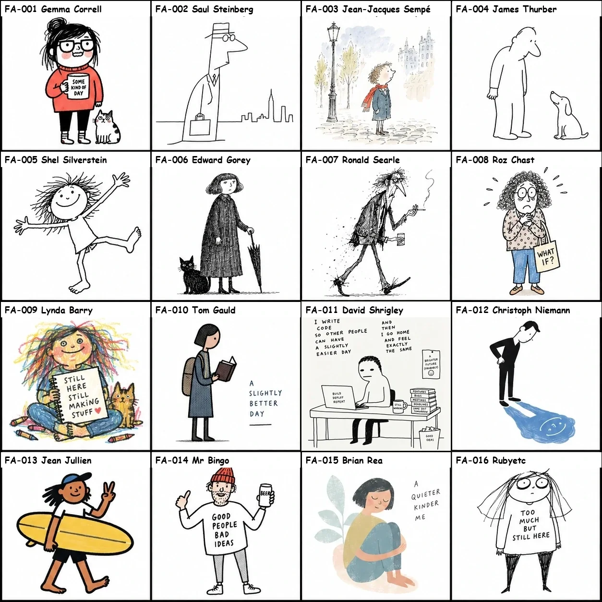
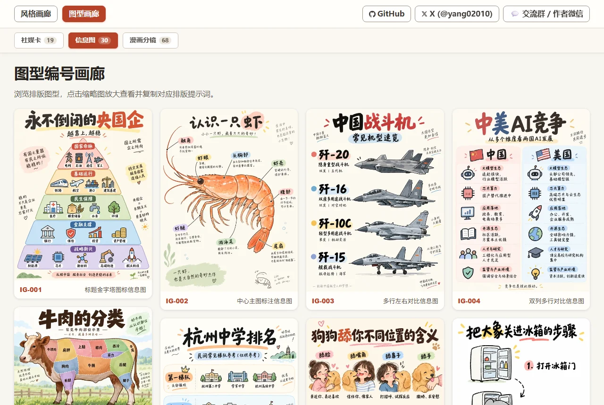
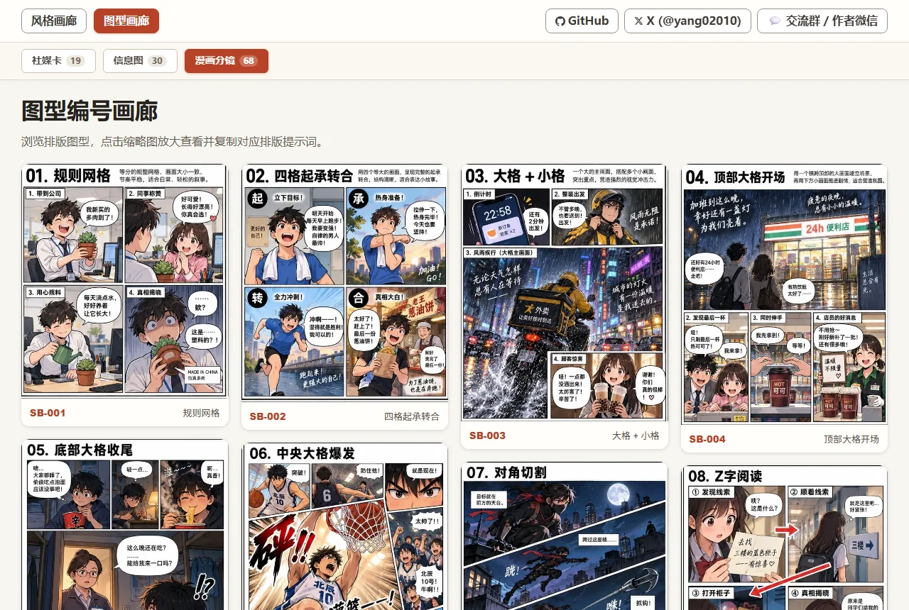

# bonin-handraw-style · 手绘风格提示词引擎

> Bonin AIGC 技能集合成员 —— [www.boninaigc.top](https://www.boninaigc.top)
> 成就超级个体和团队 / Empower Super-Individuals and Super-Teams

把「风格编号 + 主题」组装成出版级中英双语生图提示词：367 种编号手绘风格（#001–#367）、36 组主题色（C-01–C-36）与 170 种排版图型，并支持封面设计、风格融合、IP 设计等扩展工作流。

## 安装

将本目录整体复制到宿主的技能目录，保持 `images/`、`scripts/`、`skills/` 与根 `SKILL.md` 在同一包根下：

```
~/.claude/skills/bonin-handraw-style/     # Claude Code / Claude CLI
~/.agents/skills/bonin-handraw-style/     # 通用 agents 目录
```

安装后由根 [SKILL.md](SKILL.md) 作为唯一入口，按请求自动路由到对应子技能；运行依赖边界见 [DEPENDENCIES.md](DEPENDENCIES.md)。

## 库索引

- **风格库（367 种手绘风格）**
  - 速查表：[STYLES.md](STYLES.md) / [STYLES_en.md](STYLES_en.md)
  - 详细表格（200 种风格精编）：[styles_200_reorganized.md](styles_200_reorganized.md)
  - 代表风格拼图预览：
- **排版图型库（170 种排版图型：24 种社媒卡、38 种数据信息图、71 种漫画分镜、13 种 IP 设计、24 种电商图型）**
  - 总表：[LAYOUTS.md](LAYOUTS.md) / [LAYOUTS_en.md](LAYOUTS_en.md)
  - [社媒卡 Social Cards](LAYOUTS.md#social-cards) — 
  - [信息图 Infographics](LAYOUTS.md#infographics) — 
  - [漫画分镜 Comic Storyboards](LAYOUTS.md#comic-storyboards) — 
- **主题色库（36 组）**：[COLORS.md](COLORS.md) / [COLORS_en.md](COLORS_en.md) — 色卡预览：
- **组装教程**：[TUTORIALS.md](TUTORIALS.md) / [TUTORIALS_en.md](TUTORIALS_en.md)

## 使用

默认只产出提示词，不直接调用生图工具。常用指令形态：

- `风格：FA-013，主题：秋分` — 输出该风格的完整双语提示词
- `切换为图文模式` — 追加排版图型与主题色组装
- 未指定风格/主题色时，自动实时推荐最优组合

## 子技能（由根 SKILL.md 统一路由）

`skills/` 目录下包含 15 个功能模块：

| 模块 | 用途 |
| :--- | :--- |
| handdraw-style-prompter | 核心画风解析与提示词组装契约 |
| article-illustration-planner | 文章配图规划 |
| article-cover-designer | 文章/视频封面设计（2.35:1） |
| poster-prompt-generator | 海报提示词生成 |
| style-fusion-prompter | 双风格融合提示词 |
| ip-designer | IP 角色设计手册（18 卡） |
| couple-photo-orchestrator | 情侣/写真拍摄企划 |
| custom-asset-manager | 自建角色/道具/场景资产库 |
| personal-library | 个人图库本地管理 |
| style-library-importer | 新画风录入 |
| tweet-style-importer | 推文画风抓取入库 |
| layout-library-importer | 排版图型录入 |
| style-business-analyzer | 风格商业应用指南 |
| release-illustration-planner | 发布插画规划 |
| community-share | 作品分享与静态画廊发布 |

---

© Bonin AIGC · <https://www.boninaigc.top>
