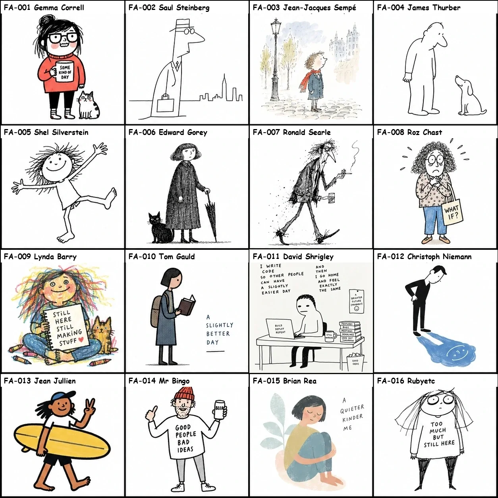
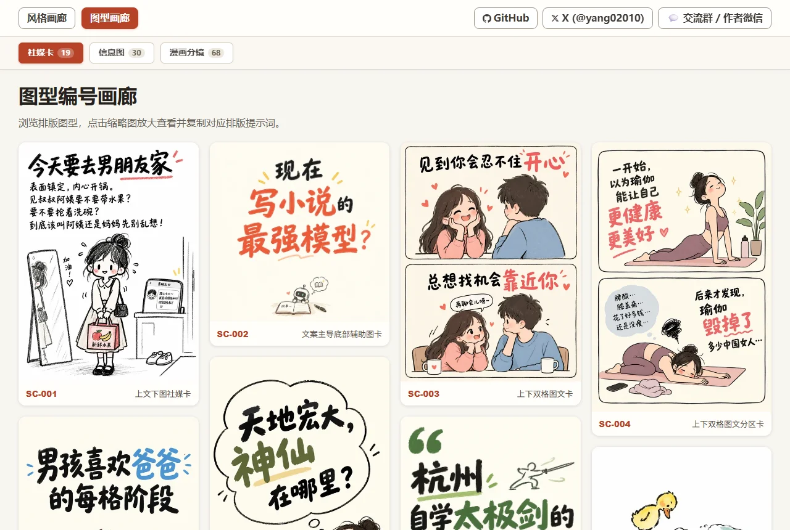
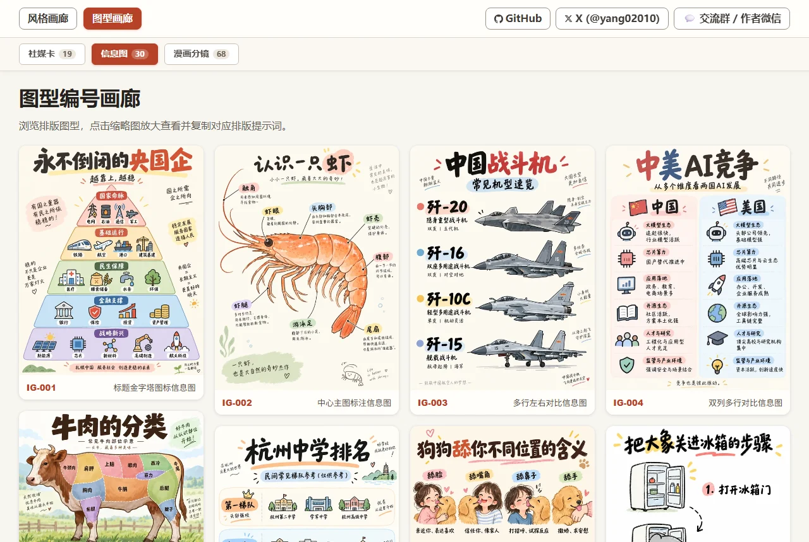
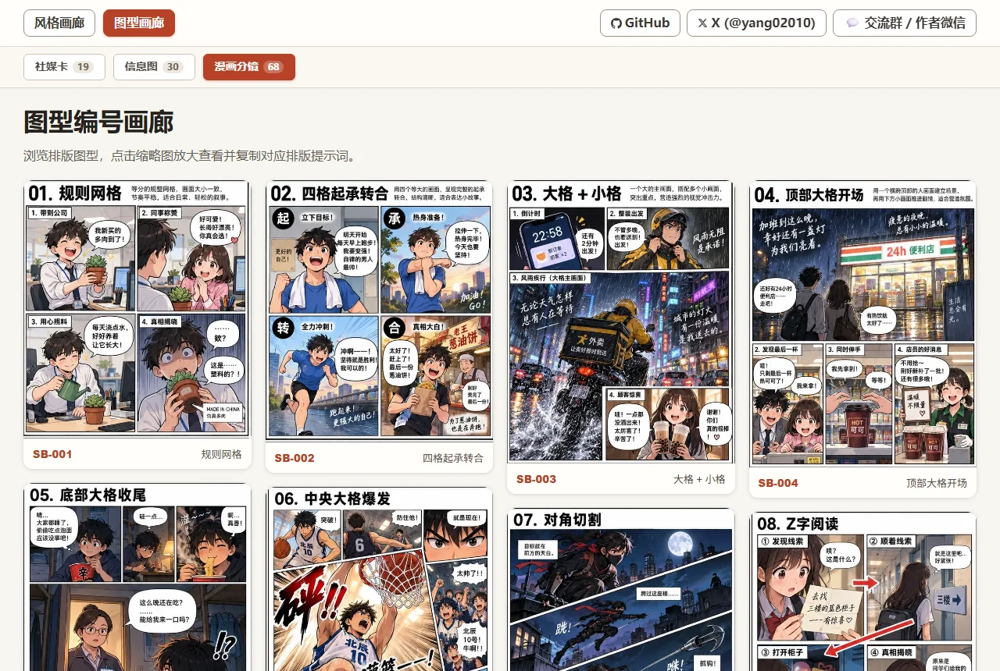
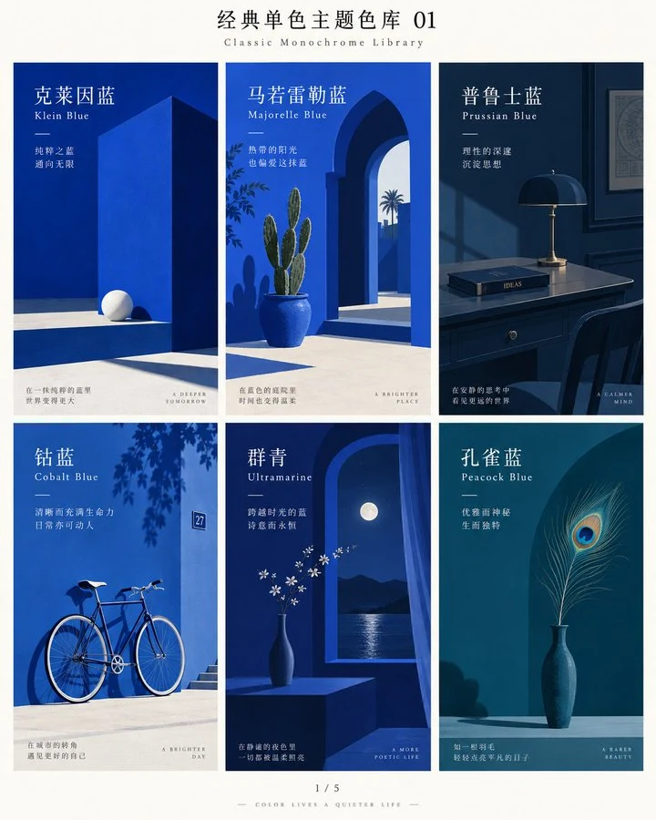

# bonin-handraw-style · Hand-Drawn Style Prompt Engine

> Part of the [Bonin AIGC](https://www.boninaigc.top) skills collection
> Empower Super-Individuals and Super-Teams

Assemble "style number + theme" into publication-grade bilingual image prompts: 367 numbered hand-drawn styles (#001–#367), 36 theme-color palettes (C-01–C-36), and 170 composition layouts, plus extended workflows for cover design, style fusion, and IP character design.

## Install

Copy this directory as a whole into your host's skills folder, keeping `images/`, `scripts/`, `skills/` and the root `SKILL.md` under the same package root:

```
~/.claude/skills/bonin-handraw-style/     # Claude Code / Claude CLI
~/.agents/skills/bonin-handraw-style/     # Generic agents directory
```

The root [SKILL.md](SKILL.md) is the single entrypoint and routes requests to sub-skills automatically; see [DEPENDENCIES.md](DEPENDENCIES.md) for the bundled-vs-external dependency boundary.

## Library Index

- **Style library (367 hand-drawn styles)**
  - Quick reference: [STYLES_en.md](STYLES_en.md) / [STYLES.md](STYLES.md)
  - Curated table: [styles_200_reorganized.md](styles_200_reorganized.md)
  - Representative contact sheet: 
- **Layout library (170 composition layouts: 24 Social Cards, 38 Infographics, 71 Comic Storyboards, 13 IP Design, 24 E-commerce)**
  - Full index: [LAYOUTS_en.md](LAYOUTS_en.md) / [LAYOUTS.md](LAYOUTS.md)
  - [Social Cards](LAYOUTS.md#social-cards) — 
  - [Infographics](LAYOUTS.md#infographics) — 
  - [Comic Storyboards](LAYOUTS.md#comic-storyboards) — 
- **Theme-color library (36 palettes)**: [COLORS_en.md](COLORS_en.md) / [COLORS.md](COLORS.md) — sheet: 
- **Assembly tutorials**: [TUTORIALS_en.md](TUTORIALS_en.md) / [TUTORIALS.md](TUTORIALS.md)

## Usage

By default this skill produces prompts only and does not call image-generation tools. Typical requests:

- `Style: FA-013, Theme: autumn equinox` — full bilingual prompt for that style
- `Switch to graphic-text mode` — append layout and theme-color assembly
- When style/theme color is unspecified, an optimal combination is recommended automatically

## Sub-skills (routed by the root SKILL.md)

The `skills/` directory bundles 15 functional modules: handdraw-style-prompter (core contract), article-illustration-planner, article-cover-designer, poster-prompt-generator, style-fusion-prompter, ip-designer, couple-photo-orchestrator, custom-asset-manager, personal-library, style-library-importer, tweet-style-importer, layout-library-importer, style-business-analyzer, release-illustration-planner, community-share.

---

© Bonin AIGC · <https://www.boninaigc.top>
